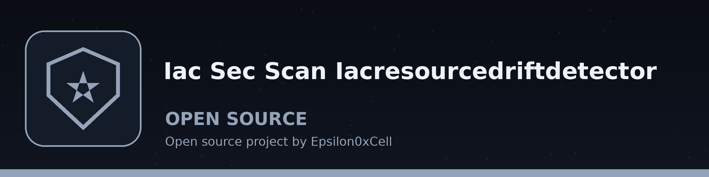

# iac-sec-scan-IaCResourceDriftDetector
Compares the declared state in an IaC file with an actual-state file holding the deployed values in the same parsed shape, and reports each differing path with the declared value and the actual value. That is the whole tool: it does not contact AWS, Azure, or GCP, it uses no cloud SDK, and it does not scan for security misconfigurations, compliance violations, or best practice deviations, and it offers no remediations. The cloud provider argument records which provider the two files describe; the comparison itself is over the two files for every provider. The exit code is 1 when drift is found, when either file parses to an empty structure, or when a requested report cannot be written, and 0 when the two files match. Dependencies: `python-hcl2` and `PyYAML`, listed in requirements.txt.

## Install
`git clone https://github.com/ShadowStrikeHQ/iac-sec-scan-iacresourcedriftdetector`

## Usage
`python3 main.py --iac_file declared.yaml --actual_file actual.yaml --cloud_provider aws --drift_report report.txt`

## Parameters
- `-h`: Show help message and exit
- `--iac_file`: Path to the IaC file holding the declared state (Terraform, YAML, or JSON)
- `--actual_file`: Path to the file holding the actual deployed state in the same parsed shape
- `--cloud_provider`: Cloud provider the two files describe (aws, azure, gcp)
- `--drift_report`: Path to save the drift report (optional). It may not be either input file; the run refuses at exit 1 rather than overwrite an input.
- `--log_level`: Set the logging level.

## License
Copyright (c) ShadowStrikeHQ
